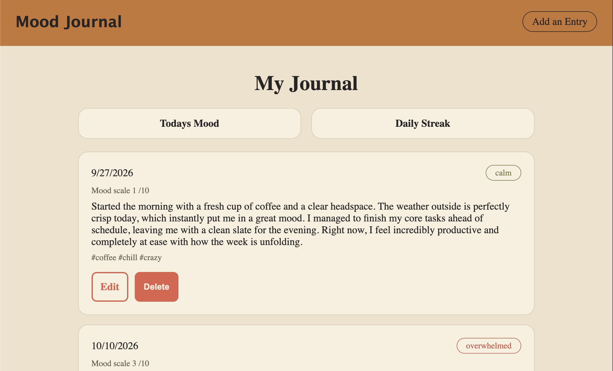

# 📓 Mood Journal

A private space to check in with yourself, one entry at a time.

**Live Demo:** [[Live Site/](https://mood-journal-xjxg.onrender.com/entries)]

---

## 📖 About

Mood Journal lets users write a daily entry and tag it with how they're feeling. Entries are saved to a database, so users can look back over time and see how their moods change. Any entry can be edited or deleted later.


---

## 🛠️ Built With

Node.js · Express · MongoDB · Mongoose · EJS [· Passport.js, if you added login]

---

## 📸 Preview



---

## 💡 What I Learned

- Designing a schema for user-written entries
- Full CRUD with Express and Mongoose
- Working with dates and sorting entries by newest
- Rendering a list of entries with EJS loops

---

## 🚀 Run It Locally

```bash
git clone https://github.com/smayanja3/[repo-name].git
cd [repo-name]
npm install
```

Create a `.env` file:

```
MONGODB_URI=your-mongodb-connection-string
PORT=5030
```

Then run `npm run dev` and open `http://localhost:5030`.